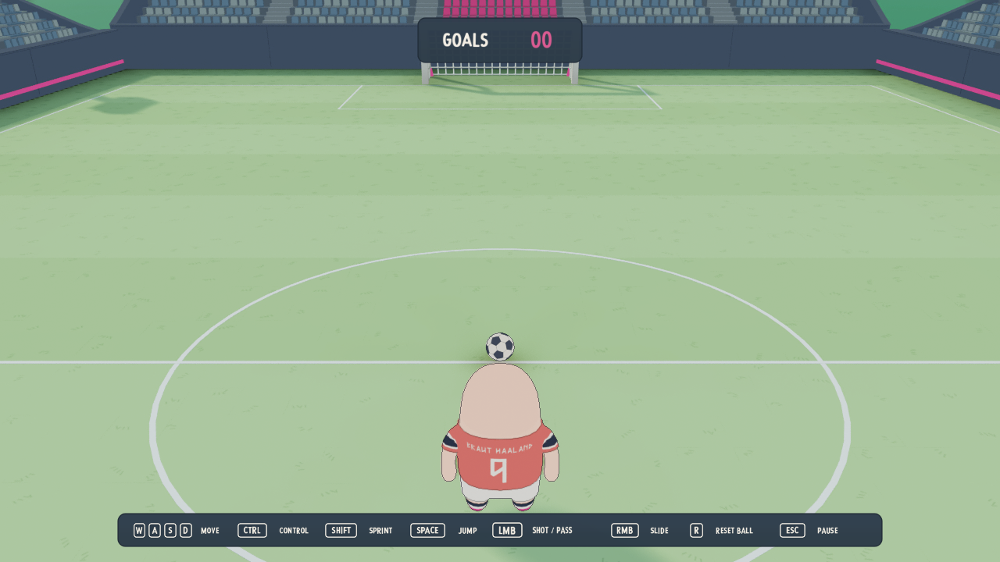
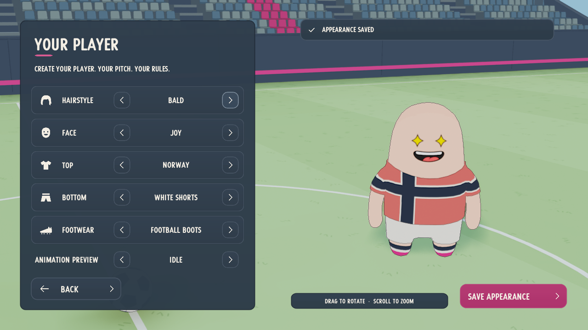
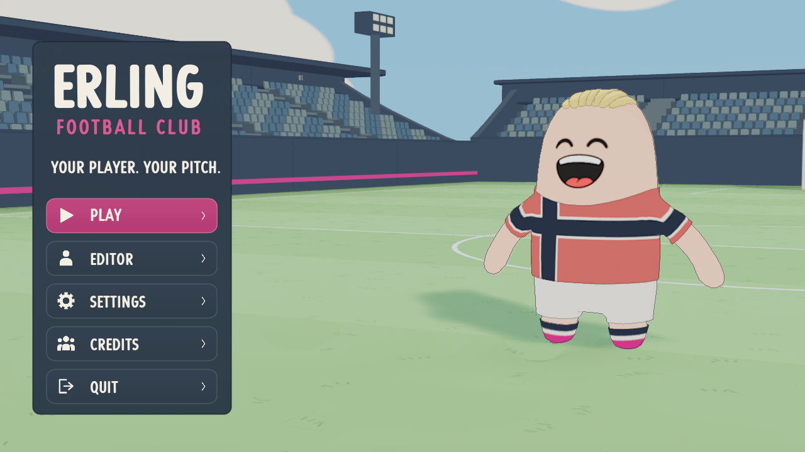

<p align="center">
  
</p>

<p align="center"><b>Your player. Your pitch. Your rules.</b><br>
A stylized football playground and modular character creator in Unreal Engine.</p>

<p align="center">
  
  
  
</p>

<p align="center">
  <a href="README.pl.md">Polski</a> · <b>English</b> ·
  <a href="#quick-start">Quick start</a> · <a href="#screenshots">Screenshots</a> ·
  <a href="#highlights">Features</a> · <a href="#controls">Controls</a> ·
  <a href="#authorship-and-licence">Credits & licence</a>
</p>

**Erling** is a personal gameplay, animation and UI portfolio project by **Daniel Maciej Pytel**.
Run, sprint, dribble, charge shots, jump, slide and celebrate goals in a small football sandbox.

## Screenshots

Actual runtime captures from the development project.



| Character creator | Main menu |
|:---:|:---:|
|  |  |

## Highlights

- **Foot-aware dribbling** — the ball reacts to the character's left and right foot positions instead of simply following a fixed point. Sprinting uses a contact, release and chase cycle so the player visibly pushes the ball forward and catches up to it.
- **Physics-based ball interaction** — charged shots, ground passes, goal detection, net collision, missed-shot handling and ball reset are built around the simulated ball.
- **Custom animation runtime** — 17 animation clips cover locomotion, kicks, jumps, turns, slides, celebrations and emotes. Gait transitions preserve animation phase and blend between clips while CharacterMovement owns world motion. Goal celebrations include a flip, Disco, Robot and Shrug.
- **Three gameplay cameras** — **Free** allows manual camera rotation, **Player** follows the player's back, and **Pitch** provides a football-style pitch view, with camera-relative movement where appropriate.
- **Keyboard, mouse and gamepad support** — gameplay and character-editor controls are mapped for both desktop input and Xbox-style controllers.
- **Modular character creator** — hairstyle, face, shirt, shorts and footwear are assembled from skeletal-mesh pieces driven by `wardrobe.json`, with saved appearance presets.
- **Animated layered faces** — six expressions (smile, joy, anger, surprise, sleepy, tired) are built from separate brow, eye, pupil, lid, teeth, tongue and mouth layers. A single material composites them and moves individual layers, so each face blinks, glances, raises its brows or sways its tongue in its own way, and switching faces cross-fades smoothly.
- **UMG UI and HUD** — main menu, character editor, settings, pause screen, credits, goal counter, contextual shot feedback and an in-game control strip share one visual language in a single widget blueprint, with English and Polish text.
- **Persistent settings** — appearance, camera mode, sensitivity, audio levels and graphics quality are stored through Unreal's save system.

## Controls

| Action | Keyboard / Mouse | Xbox-style gamepad |
| --- | --- | --- |
| Move | `WASD` | Left stick |
| Camera | Mouse | Right stick |
| Ball control | `Left Ctrl` | `LT` |
| Sprint | `Left Shift` | `RT` |
| Jump / goal celebration | `Space` | `A` |
| Charge and release shot | Hold / release `LMB` | Hold / release `X` |
| Slide | `RMB` | `B` |
| Reset ball | `R` | `Y` |
| Pause | `Esc` | Menu button |

The character editor also supports drag-to-rotate, `Q` / `E` rotation and mouse-wheel zoom. The right stick provides rotation and zoom on a gamepad.

## Technical overview

- Unreal Engine 5.8
- C++ gameplay, movement, animation and UI logic
- UMG menus and HUD: a `UErlingInterface` (`UUserWidget`) C++ base class drives `WBP_ErlingInterface`, which the `ErlingUIEditor` commandlet builds from an asset manifest
- Unreal physics simulation for the ball and goal net
- Custom `UAnimInstance` proxy for clip sampling and blending
- Custom `UCharacterMovementComponent` behavior for momentum and action movement
- Layered face material: full-canvas expression layers packed into one `Texture2DArray`, composited and animated per layer through material parameters set from C++
- JSON-driven modular wardrobe data
- `USaveGame` persistence for player appearance and settings

The pitch, gameplay state and core interaction systems are created and controlled from the runtime code, while the character, animations, materials, audio and map assets live under `Content/Erling`.

## Quick start

- Windows 64-bit, Git and Git LFS.
- Unreal Engine **5.8**; the local engine installation used for this maintenance work is **5.8.4**. Other engine versions have not been verified.
- Visual Studio 2022 with the **Game development with C++** workload, MSVC and the Windows SDK required by that Unreal Engine installation. Both project targets select Visual Studio 2022.

Install Git LFS before cloning, then run the following from the repository directory:

```text
git lfs install
git lfs pull
```

Generate Visual Studio project files from `Erling.uproject`, open the generated solution, select **Development Editor / Win64** and build **Erling**. Alternatively, with `ERLING_ENGINE_ROOT` set to your engine installation, run this in Command Prompt:

```bat
"%ERLING_ENGINE_ROOT%\Engine\Build\BatchFiles\Build.bat" ErlingEditor Win64 Development -Project="%CD%\Erling.uproject" -WaitMutex -NoHotReloadFromIDE
```

Run `Start.cmd` to play using the editor runtime, or `Start.cmd -Editor` to open the project in the editor. This launcher does not build missing C++ modules and is not a packaged Shipping build.

The launcher discovers the engine through Windows registration, Epic Games Launcher installation records or the standard Epic Games installation directory. You can override discovery with an engine root (the folder containing `Engine`):

```bat
Start.cmd -EngineRoot "D:\Engines\UE_5.8"
Start.cmd -CheckOnly
```

The `ERLING_ENGINE_ROOT` environment variable supplies the same override. `-CheckOnly` validates engine discovery without launching a window. The launcher does not depend on the current working directory. If scripts are unavailable, open `Erling.uproject` directly after building.

The project enables Epic's experimental ModelContextProtocol and AllToolsets plugins for editor targets only. They must be available in the chosen engine installation; do not copy their binaries into the repository or a game release. PythonScriptPlugin and EditorScriptingUtilities are also editor-only dependencies.

## Source assets and maintenance

The repository includes the imported Unreal assets, C++ source, configuration and selected UI source art. The complete Blender/FBX authoring package and local import tools are maintained separately; cloning this repository does not reproduce the entire art-authoring environment. Existing imported assets can be used without reimporting those external source files.

`WBP_ErlingInterface` contains the editable UI layout. Do not regenerate the entire interface to make a small change: full regeneration can replace later Designer edits. After building the editor target, the dedicated command below updates only the Epic notice and its space in the credits panel:

```bat
"%ERLING_ENGINE_ROOT%\Engine\Binaries\Win64\UnrealEditor-Cmd.exe" "%CD%\Erling.uproject" -run=ErlingBuildUI -UpdateCredits -unattended -nullrhi
```

Back up the widget asset before an authoring update. Normal game startup does not rebuild the UI.

For the existing UI checks, run the built editor runtime with `-game -RenderOffscreen -unattended -ErlingUITest -ResX=1920 -ResY=1080`. Inspect `Saved/UIChecks/checks.txt` and the `ERLING_UI_CHECKS_COMPLETE` log marker; the checks use a separate test save. The basic project smoke checks use `-game -unattended -ErlingTest`. These checks are not a substitute for testing a packaged release and a physical controller.

## Authorship and licence

This is a proprietary portfolio project, not an open-source release. See [LICENSE](LICENSE) for the limited private evaluation permission and [THIRD_PARTY_NOTICES.md](THIRD_PARTY_NOTICES.md) for external materials and provenance.

Daniel Maciej Pytel created the character model in Blender. The control graphics and UI combine his Photoshop work with AI assistance based on that work. The animations are original project work created with AI assistance. Stadium elements were made in Unreal Engine using MCP tools, based on his concept artwork and visual references.

The current development assets still contain **“Haaland (Ha Ha Ha)” by CTID** and five externally sourced sound effects. The SFX sources and licences are documented and their provenance issue is resolved. Music clearance is deferred by the maintainer; no permission for game/GitHub distribution has been established. Attribution does not grant that permission. See the notices before public distribution.

## Project status

**Work in progress.** Erling is an actively developed portfolio prototype focused on responsive character control, readable football interactions and a cohesive presentation rather than a full competitive football game.

## Verification and known limitations

A clean local clone with all 353 LFS assets built and ran with UE 5.8.4 on the same
Windows development machine. This does not verify GitHub downloads or a clean OS.
After the screenshot-test correction, the basic checks passed **46/46** with an
initial 60 FPS cap; earlier UI checks passed **86/86**. The static gameplay image
is now saved before teleporting or kicking the ball.

With an initial 20 FPS cap, the basic checks passed **45/46**: `sprint_dribble_controlled`
failed. The same assertion also failed on the pre-change runner (**43/44**).
This remains a known low-FPS issue. Later graphics checks change the FPS cap.
Experimental engine toolsets also log Python initialization errors in the inspected
installation. A packaged Shipping build and physical controller have not been verified.
