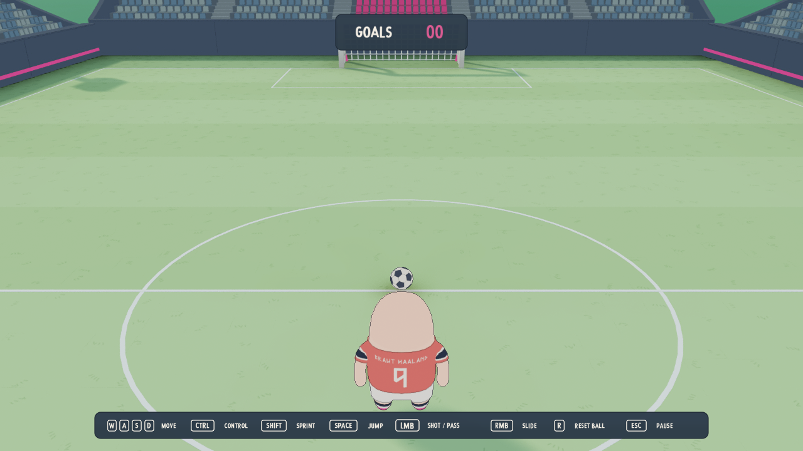
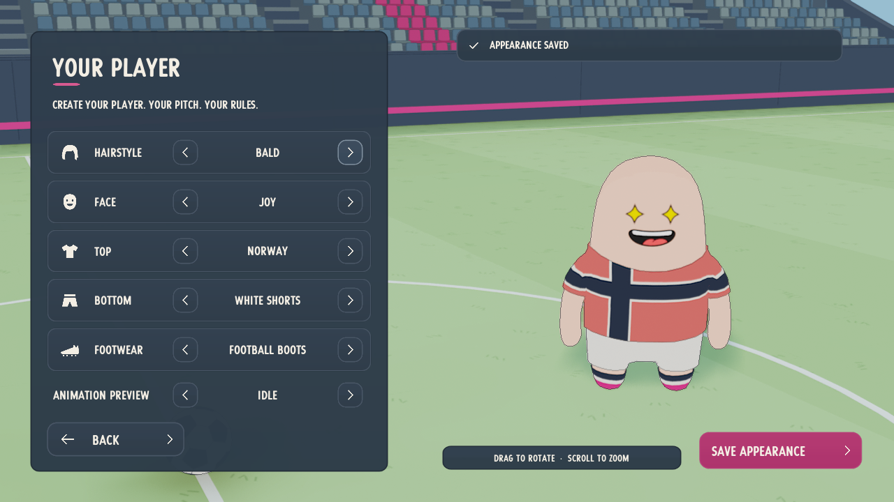
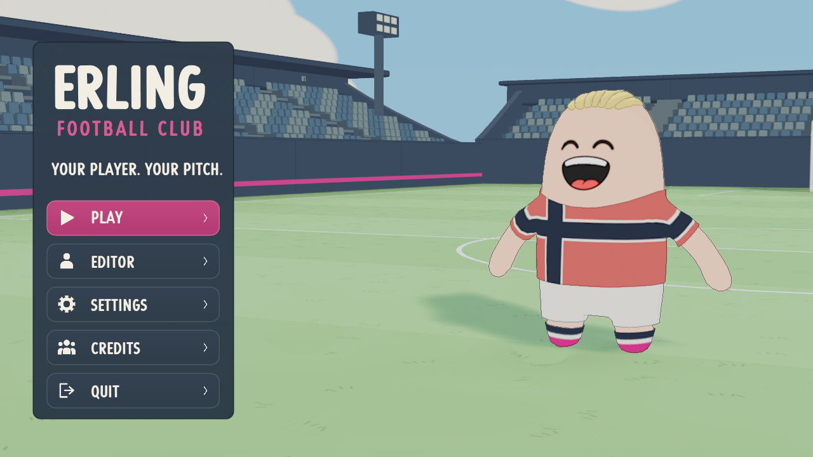

<p align="center">
  
</p>

<p align="center"><b>Twój zawodnik. Twoje boisko. Twoje zasady.</b><br>
Stylizowany piłkarski plac zabaw i modułowy kreator postaci w Unreal Engine.</p>

<p align="center">
  
  
  
  
</p>

<p align="center">
  <b>Polski</b> · <a href="README.md">English</a> ·
  <a href="#szybki-start">Szybki start</a> · <a href="#zrzuty-ekranu">Zrzuty ekranu</a> ·
  <a href="#funkcje">Funkcje</a> · <a href="#sterowanie">Sterowanie</a> ·
  <a href="#autorstwo-i-licencja">Autorstwo i licencja</a>
</p>

**Erling** to autorski projekt portfolio **Daniela Macieja Pytla**, łączący gameplay,
animację i interfejs. Mały piłkarski sandbox pozwala biegać, sprintować, prowadzić
piłkę, ładować strzały, skakać, wykonywać wślizgi i cieszyć się z goli.

## Zrzuty ekranu

Rzeczywiste ujęcia z uruchomionego projektu deweloperskiego.



| Kreator postaci | Menu główne |
|:---:|:---:|
|  |  |

## Funkcje

- **Prowadzenie piłki oparte na kontakcie stóp** — piłka reaguje na pozycje lewej i prawej stopy. Sprint obejmuje kontakt, wypuszczenie piłki i pościg.
- **Fizyczna piłka** — podania po ziemi, ładowane strzały, wykrywanie goli, kolizje z siatką, obsługa pudeł i reset.
- **Własny runtime animacji** — 17 klipów ruchu, kopnięć, skoków, obrotów, wślizgów, cieszynek i emotek. Przejścia zachowują fazę animacji, a CharacterMovement odpowiada za ruch w świecie. Cieszynki obejmują salto, Disco, Robot i Shrug.
- **Trzy kamery** — Free (swobodna), Player (za plecami zawodnika) i Pitch (widok boiska), z ruchem względem kamery tam, gdzie jest to właściwe.
- **Klawiatura, mysz i pad** — mapowania gameplayu oraz kreatora dla sterowania desktopowego i kontrolerów w układzie Xbox.
- **Modułowy kreator** — włosy, twarz, koszulka, spodenki i buty składane z części skeletal mesh, według `wardrobe.json`, z zapisem wyglądu.
- **Animowane twarze** — sześć ekspresji: uśmiech, radość, złość, zaskoczenie, senność i zmęczenie. Osobne warstwy brwi, oczu, źrenic, powiek, zębów, języka i ust tworzą mruganie, spojrzenia oraz płynne przejścia ekspresji.
- **UMG i HUD** — menu, kreator, ustawienia, pauza, credits, licznik goli, informacja o strzale i pasek sterowania; język polski i angielski.
- **Trwałe ustawienia** — wygląd, kamera, czułość, głośności i jakość grafiki zapisują się przez system zapisu Unreal.

## Sterowanie

| Działanie | Klawiatura / mysz | Pad w układzie Xbox |
| --- | --- | --- |
| Ruch | WASD | Lewy drążek |
| Kamera | Mysz | Prawy drążek |
| Kontrola piłki | Lewy Ctrl | LT |
| Sprint | Lewy Shift | RT |
| Skok / cieszynka | Spacja | A |
| Ładowanie i oddanie strzału | Przytrzymaj / puść LPM | Przytrzymaj / puść X |
| Wślizg | PPM | B |
| Reset piłki | R | Y |
| Pauza | Esc | Menu |

W kreatorze przeciąganie myszą oraz Q/E obracają postać, a kółko zmienia zbliżenie.
Prawy drążek pada obsługuje obrót i zbliżenie w kreatorze.

## Technologia

Unreal Engine 5.8; gameplay, ruch, animacja i UI w C++. Baza `UErlingInterface`
steruje `WBP_ErlingInterface`. Moduł edytorowy `ErlingUIEditor` utrzymuje widżet
przez commandlet. Piłka i siatka korzystają z fizyki Unreal. Własny proxy
`UAnimInstance` próbkuje i miesza klipy, a własny `UCharacterMovementComponent`
obsługuje pęd i ruch akcji. Warstwy twarzy znajdują się w `Texture2DArray`,
sterowane parametrami materiału z C++. Garderoba używa JSON, a ustawienia `USaveGame`.

Kod runtime tworzy i kontroluje elementy boiska oraz stan gry; zaimportowane
zasoby znajdują się w `Content/Erling`, a mapa w `Content/Maps`.

## Szybki start

1. Pobierz **[Erling 0.1.0 dla Windows x64](https://github.com/danielmaciejpytel/erling/releases/download/v0.1.0/erling_0.1.0_windows_x64.zip)** z [Releases](https://github.com/danielmaciejpytel/erling/releases/tag/v0.1.0).
2. Rozpakuj **całą paczkę ZIP** do folderu na komputerze.
3. Otwórz ten folder i uruchom **`Erling.exe`**. Katalogi `Engine` i `Erling` pozostaw obok pliku EXE.
4. Wybierz **Graj**, aby wejść na boisko, lub otwórz kreator postaci i dostosuj zawodnika.

Paczka jest samodzielnym buildem **Shipping dla Windows 64-bit**. Do gry nie potrzebujesz Unreal Engine, Visual Studio ani Gita. Jeśli Windows zgłosi brak składników Microsoft Visual C++, uruchom dołączony `Engine/Extras/Redist/en-us/vc_redist.x64.exe`, a następnie ponownie włącz grę.

## Budowanie ze źródeł

Wymagania: Windows 64-bit, Git i Git LFS, Unreal Engine **5.8** (sprawdzono
**5.8.4**) oraz Visual Studio 2022 z pakietem **Game development with C++**, MSVC
i Windows SDK wymaganymi przez silnik. Innych wersji silnika nie zweryfikowano.

Po sklonowaniu, w katalogu repozytorium:

```text
git lfs install
git lfs pull
```

Wygeneruj pliki Visual Studio z `Erling.uproject`, otwórz rozwiązanie i zbuduj
Erling w konfiguracji **Development Editor / Win64**. Alternatywnie ustaw
`ERLING_ENGINE_ROOT` i uruchom w Command Prompt:

```bat
"%ERLING_ENGINE_ROOT%\Engine\Build\BatchFiles\Build.bat" ErlingEditor Win64 Development -Project="%CD%\Erling.uproject" -WaitMutex -NoHotReloadFromIDE
```

`Start.cmd` uruchamia grę w runtime edytora, a `Start.cmd -Editor` otwiera edytor.
Launcher nie kompiluje brakujących modułów i nie jest paczką Shipping.
Wykrywa silnik z rejestru Windows, danych Epic Games Launcher lub standardowego
katalogu instalacji. Własną lokalizację podaj tak:

```bat
Start.cmd -EngineRoot "D:\Engines\UE_5.8"
Start.cmd -CheckOnly
```

Zmienna `ERLING_ENGINE_ROOT` zapewnia to samo nadpisanie ścieżki. `-CheckOnly`
sprawdza wykrywanie bez otwierania okna. Launcher działa niezależnie od bieżącego
katalogu. Po kompilacji można również otworzyć `Erling.uproject` bezpośrednio.

Projekt włącza eksperymentalne pluginy Epic ModelContextProtocol i AllToolsets
wyłącznie dla edytora. Muszą być dostępne w wybranej instalacji silnika; nie kopiuj
ich binariów do repozytorium lub wydania. PythonScriptPlugin i
EditorScriptingUtilities również są zależnościami edytorowymi.

## Źródła i utrzymanie

Repo zawiera zaimportowane assety Unreal, kod, konfigurację i wybrane źródła UI.
Pełny zestaw autorski Blender/FBX i lokalne narzędzia importu są utrzymywane osobno.
Do korzystania z istniejących assetów nie trzeba ich ponownie importować.

`WBP_ErlingInterface` zawiera edytowalny układ UI. Pełna regeneracja może zastąpić
późniejsze zmiany Designera. Po kompilacji modułu edytorowego można zmienić tylko
notice Epic i jego przestrzeń w credits:

```bat
"%ERLING_ENGINE_ROOT%\Engine\Binaries\Win64\UnrealEditor-Cmd.exe" "%CD%\Erling.uproject" -run=ErlingBuildUI -UpdateCredits -unattended -nullrhi
```

Przed aktualizacją autorską zabezpiecz widżet. Normalny start nie przebudowuje UI.
Test UI uruchamia runtime z `-game -RenderOffscreen -unattended -ErlingUITest
-ResX=1920 -ResY=1080`. Wynik jest w `Saved/UIChecks/checks.txt`, a zakończenie
potwierdza `ERLING_UI_CHECKS_COMPLETE`. Test korzysta z osobnego zapisu.
Podstawowy zestaw uruchamia `-game -unattended -ErlingTest`.

## Autorstwo i licencja

To autorskie portfolio na licencji własnościowej, z ograniczoną zgodą na prywatną
ocenę. Warunki: [LICENSE](LICENSE). Źródła i materiały zewnętrzne:
[THIRD_PARTY_NOTICES.md](THIRD_PARTY_NOTICES.md).

Daniel Maciej Pytel wykonał model postaci w Blenderze. UI i grafiki sterowania
łączą jego pracę w Photoshopie z pomocą AI opartą na tej pracy. Animacje to własna
praca projektowa z pomocą AI. Elementy stadionu powstały w Unreal Engine z użyciem
MCP, na podstawie jego concept artu i referencji wizualnych.

Muzyka w tle: **„Haaland (Ha Ha Ha)” — CTID**. Efekty dźwiękowe: **Pixabay**,
w tym **„Good!” autorstwa syseQ**, pochodzący z Freesound. Nazwy plików, autorzy,
źródła i licencje znajdują się w [THIRD_PARTY_NOTICES.md](THIRD_PARTY_NOTICES.md).

## Stan projektu

**Prace w toku.** Prototyp skupia się na responsywnym sterowaniu, czytelnych
interakcjach piłkarskich i spójnej prezentacji. Nie jest pełną grą piłkarską
z rozgrywką turniejową.

## Weryfikacja i znane ograniczenia

Czysty lokalny klon z 353 assetami LFS zbudowano i uruchomiono w UE 5.8.4 na tym
samym komputerze Windows. Nie sprawdza to pobierania z GitHuba ani czystego systemu.
Po poprawce testowego zrzutu zestaw podstawowy zaliczył **46/46** przy początkowym
limicie 60 FPS; wcześniejsze testy UI **86/86**. Zrzut gry powstaje przed teleportem
i kopnięciem piłki.

Przy początkowym limicie 20 FPS wynik wynosi **45/46**: nie przechodzi
`sprint_dribble_controlled`. Ta sama asercja nie przechodziła przed poprawką
(**43/44**). To znany problem przy niskim FPS. Późniejsze testy grafiki zmieniają
limit klatek. Eksperymentalne toolsety silnika zgłaszają błędy inicjalizacji Pythona.
Paczka **Shipping 0.1.0 dla Windows x64** została zbudowana, a autor potwierdził
ją wizualnie. Testy źródeł wydania w runtime edytora zaliczyły **46/46**
(podstawowe) i **86/86** (UI). Nie zweryfikowano czystego systemu Windows
ani fizycznego kontrolera.
